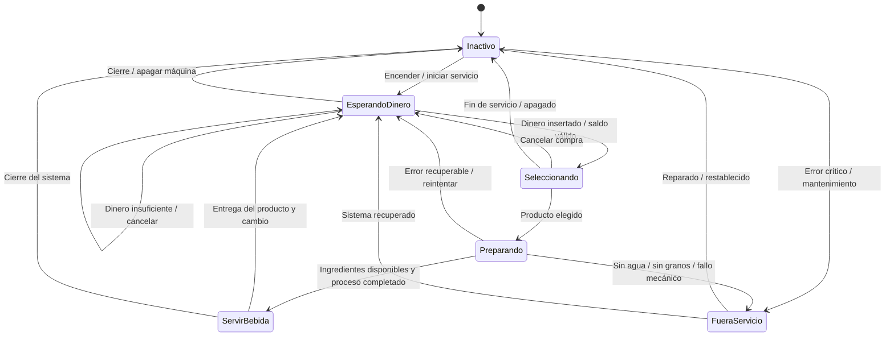

# Máquina vending de café

Este proyecto incluye una propuesta de diagrama de estados para una máquina expendedora de café, basada en el flujo típico de una máquina vending.

## Descripción del comportamiento

La máquina pasa por varios estados según el usuario interactúa con ella:

- La máquina está apagada o inactiva.
- El cliente inserta dinero o el saldo disponible.
- El usuario elige un producto.
- La máquina valida stock, agua, azúcar, granos y dinero.
- Si todo está correcto, prepara la bebida.
- Finaliza entregando el producto y el cambio.
- En caso de fallo, entra en mantenimiento o fuera de servicio.

## Diagrama de estados

## Explicación de los estados

### 1. Inactivo
La máquina está lista pero no hay operación en curso. Puede pasar a `EsperandoDinero` cuando se activa.

### 2. EsperandoDinero
El usuario aún no ha abonado suficiente dinero para seleccionar el producto. Aquí se puede:
- insertar monedas o billetes,
- cancelar la operación,
- o dejar la máquina en espera.

### 3. Seleccionando
El cliente ya ha introducido dinero y el sistema acepta la compra. Ahora puede elegir entre los productos ofertados.

### 4. Preparando
La máquina valida la disponibilidad del café, agua, azúcar, vasos, etc. Si todo está bien, empieza a preparar la bebida.

### 5. ServirBebida
La bebida se entrega al cliente. Se puede devolver cambio y resetear el proceso para otra compra.

### 6. FueraServicio
Cuando hay un fallo técnico o faltan recursos críticos (agua, granos, vaso, etc.), la máquina entra en mantenimiento.

## Regla general de transición

La máquina sigue este ciclo lógico:

`Inactivo -> EsperandoDinero -> Seleccionando -> Preparando -> ServirBebida -> EsperandoDinero`

Y puede desviarse a `FueraServicio` si ocurre un problema.

## Ejemplo de flujo

1. La máquina inicia en `Inactivo`.
2. El cliente insertó dinero y pasa a `EsperandoDinero`.
3. El usuario elige un café y pasa a `Seleccionando`.
4. El sistema valida el producto y entra en `Preparando`.
5. Cuando termina, pasa a `ServirBebida`.
6. Se entrega el café y vuelve a `EsperandoDinero` para una nueva compra.

## Objetivo

Este diagrama sirve como base para modelar el comportamiento de una máquina vending de café, tanto para un proyecto de software como para una explicación de autómatas o máquinas de estados.
